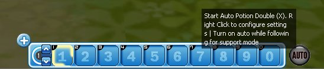
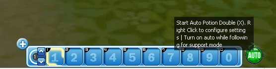
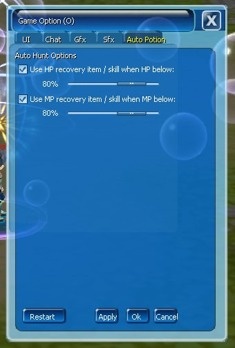

Fitur Auto Potion membantu karakter menggunakan potion secara otomatis ketika HP atau MP mencapai persentase yang telah ditentukan.

## Cara Mengaktifkan

<Steps>
  <Step title="Klik tombol AUTO">Klik tombol **AUTO** di bagian kanan Skill Bar.</Step>
  <Step title="Buka tab Auto Potion">Pilih tab **Auto Potion** pada Game Option.</Step>
  <Step title="Centang HP dan/atau MP">Centang pengaturan HP dan/atau MP.</Step>
  <Step title="Atur persentase">Atur persentase penggunaan potion.</Step>
  <Step title="Terapkan">Klik **Apply**.</Step>
</Steps>

<Frame caption="OFF">
  
</Frame>

<Frame caption="ON">
  
</Frame>

<Frame caption="Setting Auto Potion">
  
</Frame>
