Castle Siege adalah pertempuran skala besar berdurasi **90 menit**, di mana seluruh anggota guild dapat masuk ke dalam area pertempuran untuk bersama-sama merebutkan sebuah kastil.

| Info | Detail |
| --- | --- |
| Map | Nera Castle |
| Hari | Minggu |
| Waktu | 20:00–21:30 WIB |
| Target Kastil | Lushen |

## Mekanisme & Alur Permainan

- **Durasi Pertempuran:** berlangsung dalam batas waktu total 90 menit, tensi pertempuran terus meningkat hingga waktu berakhir.
- **Perebutan Kastil:** setiap player dari berbagai guild saling berlomba dan berperang di dalam area kastil untuk menguasai titik pusat pertahanan.
- **Proses Penguasaan (Well & Seed Water):** untuk merebut kastil, player harus menggunakan item **Seed Water** pada **well (sumur)** di area tersebut. Prosesnya memakan waktu beberapa saat, sehingga dibutuhkan kerja sama tim untuk melindungi player yang sedang melakukannya dari serangan musuh.
- **Sistem Perebutan Kembali:** setelah suatu guild menguasai kastil, guild lain tetap dapat merebutnya kembali dengan cara yang sama (Seed Water pada well) selama waktu pertempuran masih berlangsung.

## Benefit Penguasa Kastil

Guild yang berhasil menguasai dan mempertahankan kastil hingga akhir waktu pertempuran mendapatkan benefit eksklusif berupa akses ke **boss khusus** yang hanya bisa dilawan oleh anggota guild penguasa kastil tersebut.

## Panduan Masuk Ground Water

<Steps>
  <Step title="Menuju Nera Castle">
    Pergilah terlebih dahulu ke map **Nera Castle**.
    <Frame>
      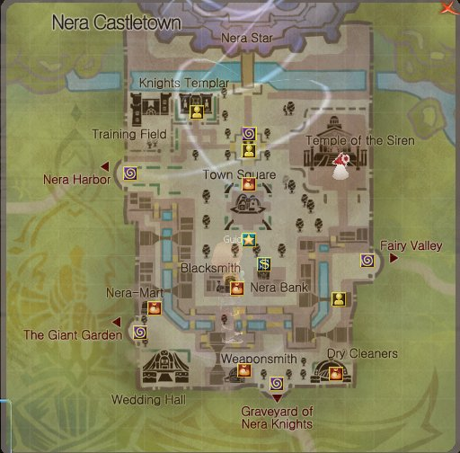
    </Frame>
  </Step>
  <Step title="Menemukan Temple of the Siren">
    Dari map Nera Castle, lanjutkan perjalanan menuju area **Temple of the Siren**.
  </Step>
  <Step title="Mencari Suspicious Candlestick">
    Di lokasi tersebut, cari sebuah lilin di sisi sebelah kiri bernama **Suspicious Candlestick**.
    <Frame>
      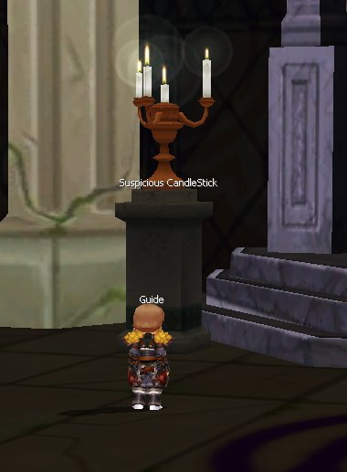
    </Frame>
  </Step>
  <Step title="Membuka Portal">
    Klik lilin tersebut, lalu pilih opsi **Turn**. Portal menuju **Ground Water** akan terbuka dan kamu bisa langsung masuk.
    <Frame>
      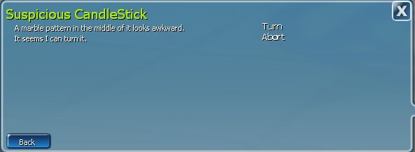
    </Frame>
    <Frame>
      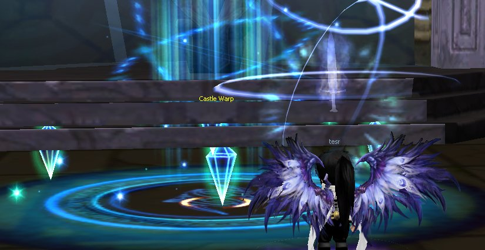
    </Frame>
  </Step>
</Steps>

## Denah Ground Water

<Frame caption="Denah lokasi map Ground Water Castle Siege">
  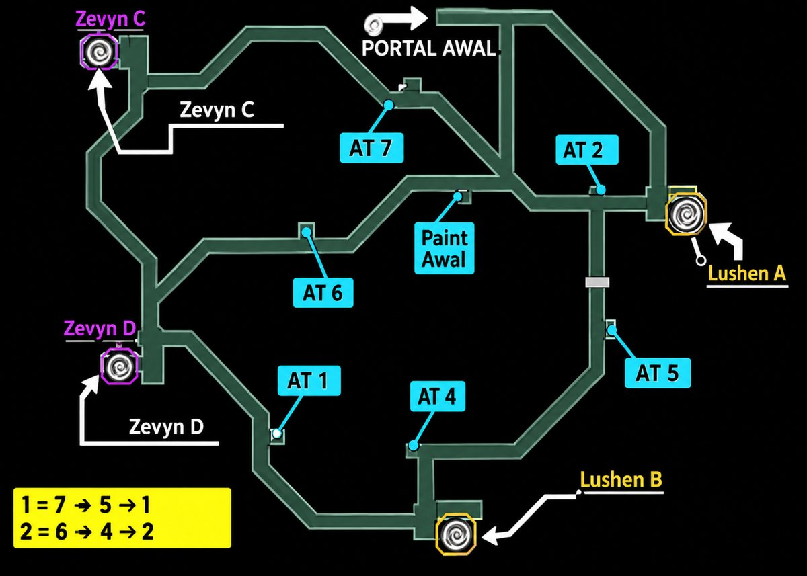
</Frame>

Pada denah terdapat titik portal awal, titik **AT 1–AT 7**, dua portal **Lushen** (A dan B), dan dua portal **Zevyn** (C dan D). Catatan di denah:

| Urutan |
| --- |
| 1 = 7 → 5 → 1 |
| 2 = 6 → 4 → 2 |

<Frame>
  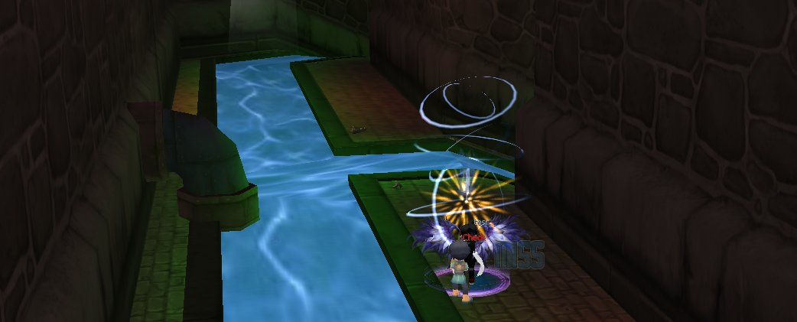
</Frame>

<Warning>
  Jika terbunuh, karakter akan keluar dari Ground Water dan kembali ke Nera Village.
</Warning>

<Frame>
  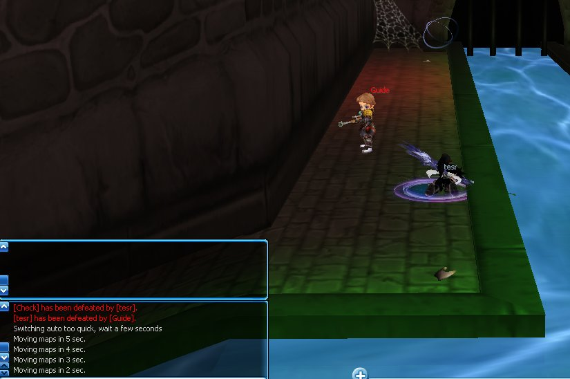
</Frame>

## Merebut Kastil

<Steps>
  <Step title="Siapkan Seed Water">
    Seed Water adalah item yang dimasukkan ke dalam well untuk merebut kastil.
    <Frame>
      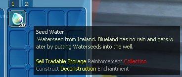
    </Frame>
  </Step>
  <Step title="Menuju Well">
    Datangi well (contoh pada gambar: Zevyn Well).
    <Frame>
      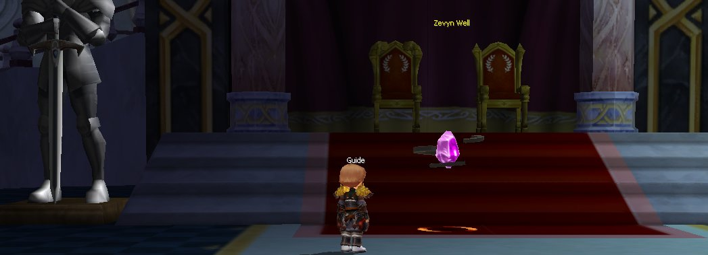
    </Frame>
  </Step>
  <Step title="Proses Seeding">
    Lakukan proses seeding untuk mendapatkan kastil, dan lindungi pemain yang sedang melakukannya.
    <Frame>
      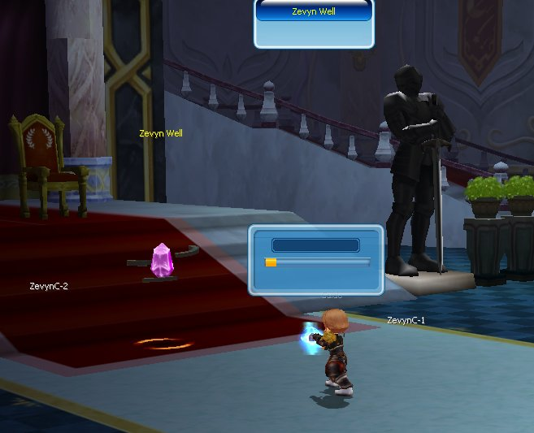
    </Frame>
  </Step>
  <Step title="Kastil Dikuasai">
    Saat berhasil, muncul pengumuman bahwa guild-mu memenangkan Castle Siege.
    <Frame>
      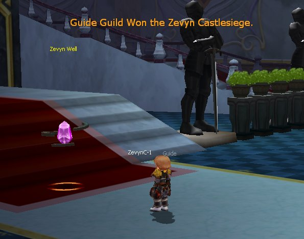
    </Frame>
  </Step>
  <Step title="Masuk ke Kastil">
    Klik **bendera Zevyn** di Nera Village untuk memasuki kastil yang kamu dapatkan.
    <Frame>
      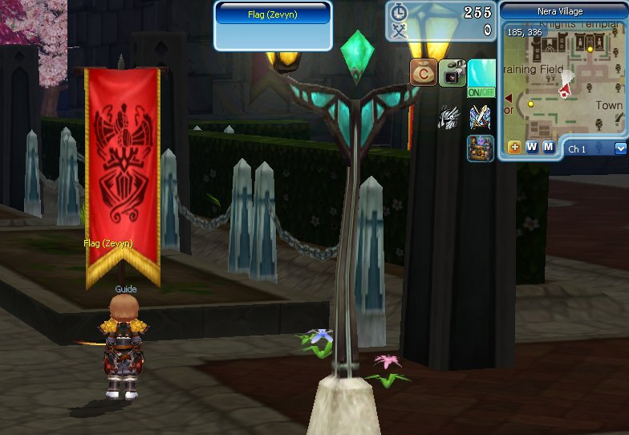
    </Frame>
    <Frame>
      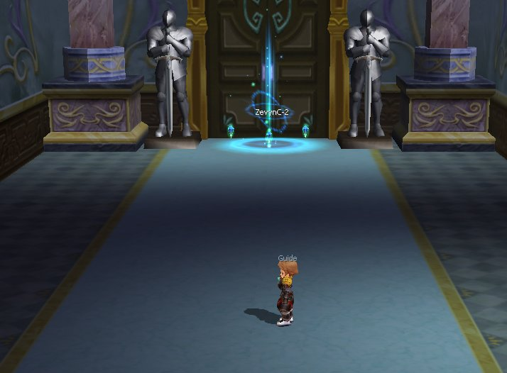
    </Frame>
  </Step>
</Steps>
