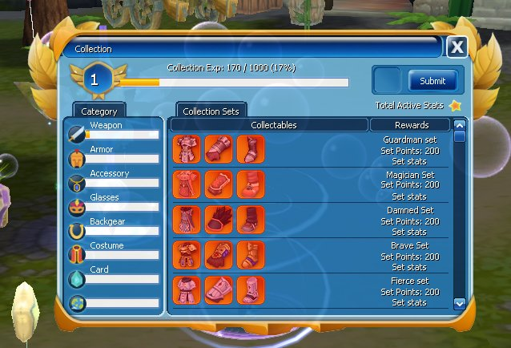
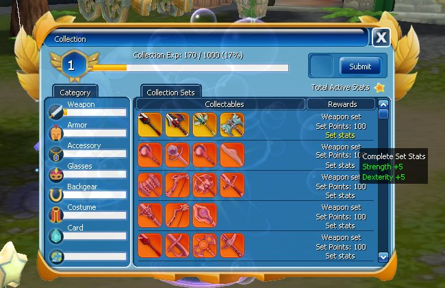

Kumpulkan berbagai barang berharga selama petualanganmu dan ubah menjadi kekuatan permanen melalui Collection System.

## Mekanisme

1. **Mengumpulkan Item Koleksi:** daftarkan item ke dalam buku koleksi, mulai dari Armor Set, Weapon (senjata), hingga Card (kartu monster).
2. **EXP Collection & Leveling:** setiap item yang dimasukkan memberikan **Collection EXP**. Seiring terkumpulnya EXP, level Collection naik, dan di setiap kenaikan level kamu mendapat bonus status permanen.
3. **Bonus Status Berbeda:** setiap jenis koleksi memberikan variasi bonus status yang unik.
4. **Reroll Status Koleksi:** sesuaikan dan cari status yang kamu inginkan dengan menekan tombol/opsi status langsung pada koleksi. Proses ini membutuhkan item **[Collection] Base Reroll Scroll**.

## Tampilan di Game

<Frame caption="Ikon Collection pada HUD">
  
</Frame>

<Frame caption="Kategori Armor: Guardman, Magician, Damned, Brave, Fierce set, dst.">
  
</Frame>

<Frame caption="Kategori Weapon, contoh bonus set: Strength +5, Dexterity +5">
  
</Frame>

Kategori yang terlihat: Weapon, Armor, Accessory, Glasses, Backgear, Costume, Card.
