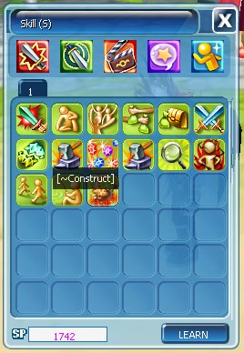
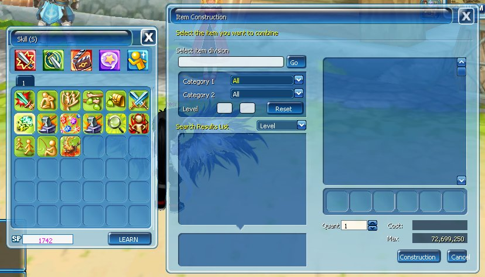

Buat berbagai item melalui kombinasi material yang tersedia di dalam game.

## Cara Mengakses

<Steps>
  <Step title="Buka Skill">Tekan **K**.</Step>
  <Step title="Pilih tab Action">
    <Frame>
      
    </Frame>
  </Step>
  <Step title="Klik skill Construct">Klik skill **Construct**.</Step>
  <Step title="Pilih item">Pilih kategori dan item yang ingin dibuat.</Step>
  <Step title="Masukkan material">Masukkan material serta jumlah item.</Step>
  <Step title="Periksa biaya">
    Periksa biaya, lalu klik **Construction**.
    <Frame>
      
    </Frame>
  </Step>
</Steps>

## Informasi Crafting

| Info | Detail |
| --- | --- |
| Kategori Item | Weaponry, Defense, Accessories, Consumables, Misc., Pet |
| Subkategori Weapon | Sword, Mace, Axe, Dagger, Staff, Bow, Musket, Pinsir |
| Craft Stat Minimum | Menunggu konfirmasi |
| Craft Stat Maksimum | Menunggu konfirmasi |
