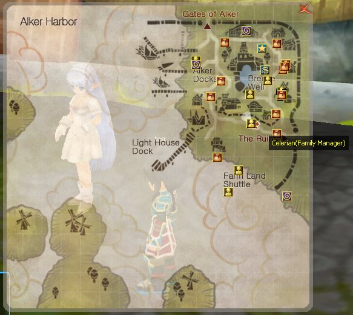
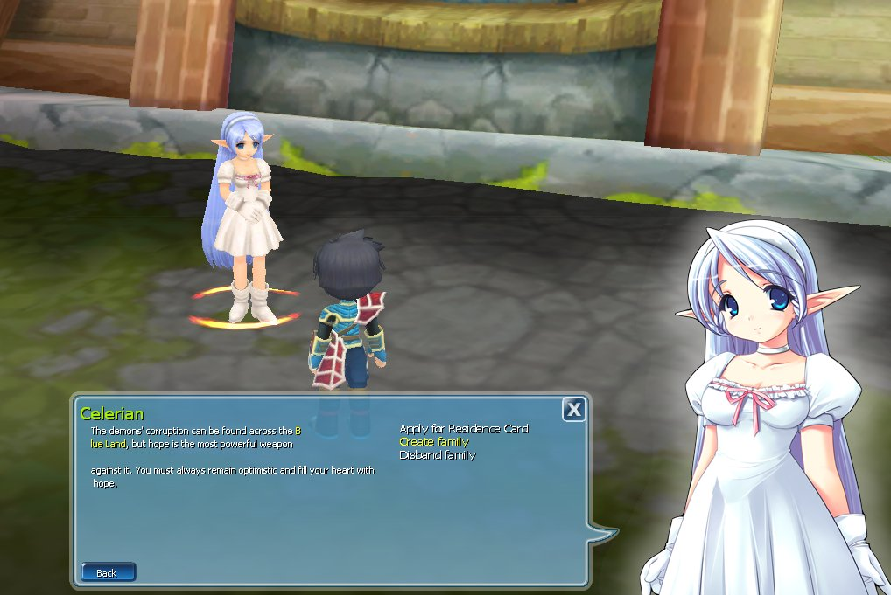
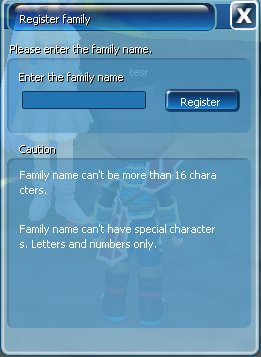
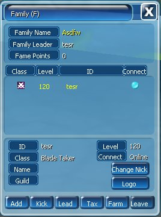

Bentuk komunitas bersama teman-teman melalui Family System. Buat Family, undang anggota, dan bangun kebersamaan bersama Adventurer lainnya.

| Info | Detail |
| --- | --- |
| NPC | Family Manager Celerian |
| Lokasi | Alker Harbor |

<Frame>
  
</Frame>

## Cara Membuat Family

<Steps>
  <Step title="Daftar sebagai Residence">
    Pastikan karakter sudah terdaftar sebagai Residence.
  </Step>
  <Step title="Temui Family Manager Celerian">
    <Frame>
      
    </Frame>
  </Step>
  <Step title="Register Family">Pilih **Register Family**.</Step>
  <Step title="Masukkan nama Family">
    <Frame>
      
    </Frame>
  </Step>
  <Step title="Klik Register">Klik **Register**.</Step>
</Steps>

## Ketentuan Nama

- Maksimal 16 karakter.
- Hanya menggunakan huruf dan angka.
- Tidak diperbolehkan menggunakan simbol.

## Pengelolaan Family

| Menu | Fungsi |
| --- | --- |
| Add | Menambahkan anggota |
| Kick | Mengeluarkan anggota |
| Lead | Mengatur kepemimpinan |
| Tax | Mengatur pajak Family |
| Farm | Mengakses Family Farm |
| Leave | Keluar dari Family |
| Logo | Menambahkan lambang Family |

<Frame>
  
</Frame>
