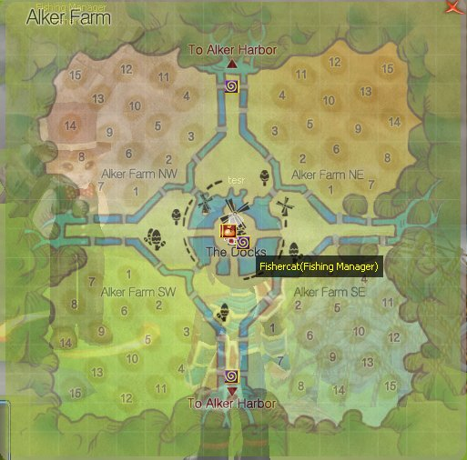
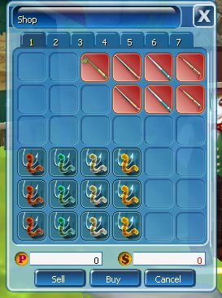
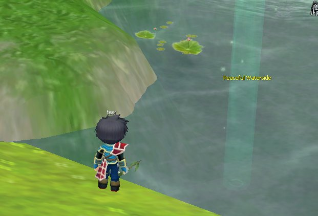
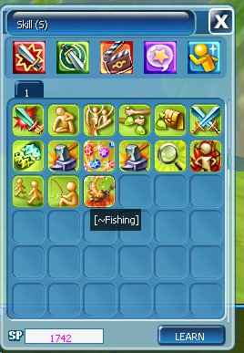
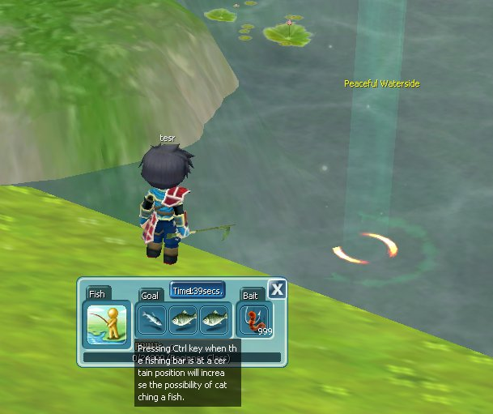
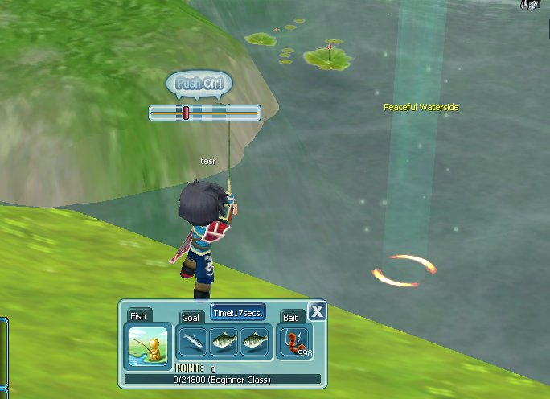
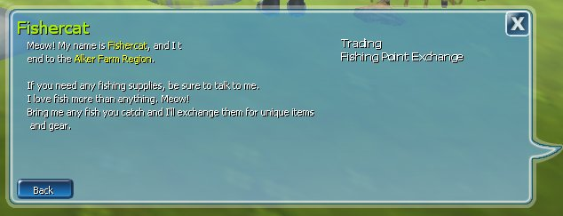
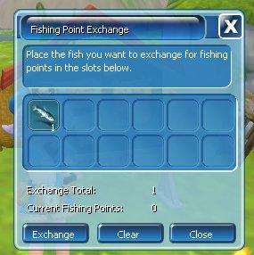

Fishing merupakan fitur life skill yang memungkinkan Adventurer menangkap ikan dan memperoleh berbagai hadiah, baik saat bermain aktif maupun AFK.

## Cara Memulai

<Steps>
  <Step title="Pergi ke Alker Farm">
    <Frame>
      
    </Frame>
  </Step>
  <Step title="Beli Fishing Rod dan Bait">
    Beli dari NPC **Fishercat**.
    <Frame>
      
    </Frame>
  </Step>
  <Step title="Pergi ke spot memancing">
    <Frame>
      
    </Frame>
  </Step>
  <Step title="Buka tab Skill">
    Tekan **K** dan buka tab Skill.
    <Frame>
      
    </Frame>
  </Step>
  <Step title="Mulai memancing">
    Pilih aksi Fishing, pasang Bait, lalu klik skill Fishing untuk memulai.
    <Frame>
      
    </Frame>
  </Step>
</Steps>

<Tip>
  Menekan tombol **Ctrl** saat bar memancing berada di posisi tertentu meningkatkan peluang menangkap ikan.
</Tip>

<Frame>
  
</Frame>

## Fishing Point Exchange

- Tukarkan ikan melalui NPC Fishercat di Alker Farm.
- Gunakan Fishing Point untuk memperoleh item dari toko NPC.

<Frame>
  
</Frame>

<Frame>
  
</Frame>

## Hadiah Ikan Spesial

| Ikan | Hadiah |
| --- | --- |
| Gold Carp | VIP Marine Hat |
| Gold Terrapin | VIP Marine Uniform |
| Shining Garbage | VIP Marine Gloves & Boots |
