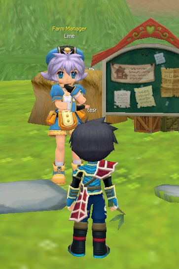
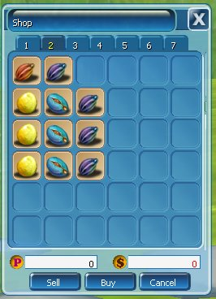
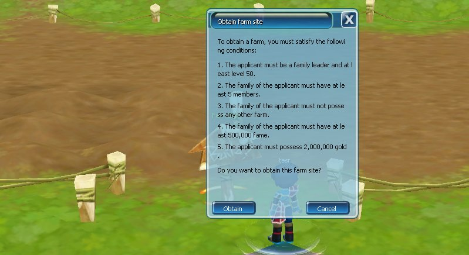

Garden System memungkinkan kamu dan **Family** (keluarga/grup in-game) mengelola sebuah lahan perkebunan.

## Fitur Utama

1. **Eksklusif untuk Family:** lahan perkebunan hanya bisa dikelola bersama oleh anggota Family. Lahan sangat terbatas, jadi pastikan Family-mu rajin merawatnya.
2. **Bercocok Tanam:** tanam berbagai jenis benih di ladang (Field). Rutin merawat, menyiram, dan menjaga tanaman hingga masa panen.
3. **Bahan Memasak & Pet Skill:** hasil panen memberi bahan utama untuk [Cooking](/fitur/cooking) serta item khusus untuk mendapatkan [Pet Skill](/fitur/pet).

## Persiapan

<Steps>
  <Step title="Buat Family">
    Lewat NPC Celerian di Alker Harbor. Lihat [Family System](/fitur/family).
  </Step>
  <Step title="Lengkapi 5 anggota">
    Family harus memiliki 5 anggota.
  </Step>
  <Step title="Miliki lahan">
    Lahan ada di Alker Farm atau Nera Farm.
  </Step>
  <Step title="Siapkan perlengkapan">
    Siapkan Seeds, Fertilizer, dan Harvest Powder.
  </Step>
</Steps>

**NPC Perlengkapan:** Lime, Alker Farm dan Nera Farm.

<Frame>
  
</Frame>

<Frame caption="Toko benih">
  
</Frame>

## Syarat Mendapatkan Lahan

<Frame>
  
</Frame>

1. Pelamar harus Family Leader dan minimal level 50.
2. Family harus memiliki minimal 5 anggota.
3. Family tidak boleh memiliki farm lain.
4. Family harus memiliki minimal 500.000 Fame.
5. Pelamar harus memiliki 2.000.000 gold.

## Cara Menanam

1. Dekati dan klik gundukan tanah.
2. Pilih Seeds dari Inventory.
3. Gunakan Fertilizer untuk memulihkan HP tanaman jika diperlukan.
4. Jaga HP tanaman selama pertumbuhan.

## Cara Memanen

1. Klik tanaman yang sudah siap dipanen.
2. Gunakan Harvest Powder.

## Upgrade Farm Land

Kunjungi NPC di depan rumah untuk mengakses opsi upgrade Farm Land dan membuka lebih banyak area tanam.
