Guild Tournament adalah ajang kompetisi PvP kompetitif antar guild. Ajang ini mempertemukan guild-guild terbaik untuk membuktikan kekuatan, kekompakan tim, dan strategi bertarung di dalam arena tertutup demi memperebutkan prestise serta hadiah eksklusif.

| Info | Detail |
| --- | --- |
| Pendaftaran | NPC Perfait di Nera Castle |
| Penutupan Pendaftaran | 19:00 WIB |
| Waktu Mulai | 20:00 WIB |
| Jumlah Guild | Minimal 4 guild, maksimal 8 guild |
| Anggota per guild | Minimal 8, maksimal 14 pemain |
| Hari | TBA |

## Mekanisme & Alur Permainan

**Sistem Pendaftaran & Kualifikasi**

- Guild yang ingin berpartisipasi harus mendaftarkan perwakilannya melalui NPC khusus sebelum turnamen dimulai.
- Pertandingan menggunakan sistem jadwal yang telah ditentukan oleh penyelenggara.

**Format Pertandingan & Penentuan Pemenang**

- Setiap guild yang bertanding memerlukan minimal 8 orang dan maksimal 14 orang player yang masuk ke arena pertempuran khusus.
- Pertandingan memiliki batasan durasi 20 menit per round.
- **Sistem Poin Kills:** guild yang lebih dulu mengumpulkan total **150 kill** sebelum waktu 15 menit habis langsung menjadi pemenang round tersebut.

**Kerja Sama & Kombinasi Kelas (Class Synergy)**

Kemenangan sangat bergantung pada kombinasi class yang seimbang, koordinasi tim, serta eksekusi serangan yang tepat di antara anggota guild di dalam arena.

**Hadiah Pemenang:** guild yang keluar sebagai pemenang akan mendapatkan hadiah spesial.

## Cara Mendaftar

<Steps>
  <Step title="Temui NPC Perfait">
    Perfait berada di Nera Castletown.
    <Frame>
      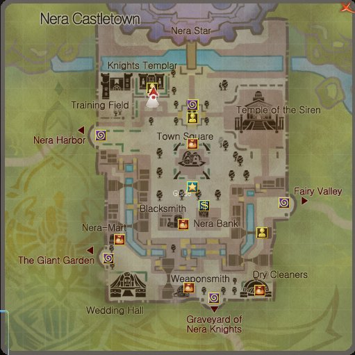
    </Frame>
    <Frame>
      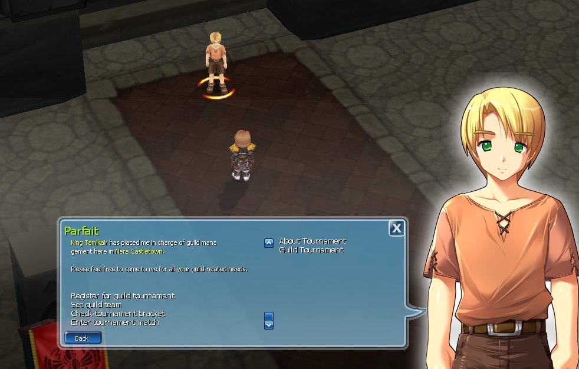
    </Frame>
    Menu NPC: Register for guild tournament, Set guild team, Check tournament bracket, Enter tournament match.
  </Step>
  <Step title="Daftarkan anggota">
    Pilih nama anggota guild di kolom kiri. Setelah terdaftar, nama anggota yang akan mengikuti Guild Tournament muncul di kolom kanan.
    <Frame>
      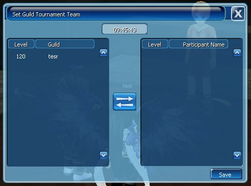
    </Frame>
  </Step>
  <Step title="Cek bracket">
    Contoh bracket guild yang sudah mendaftar ke Guild Tournament.
    <Frame>
      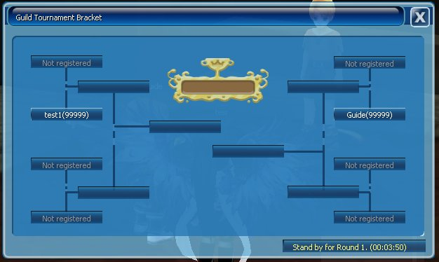
    </Frame>
  </Step>
</Steps>

## Saat Pertandingan

<Frame caption="Pop up muncul jika guildmu akan segera bertanding">
  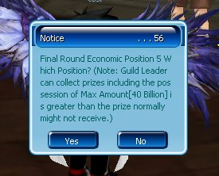
</Frame>

<Frame caption="Tempat spawn guildmu sebelum pertandingan dimulai">
  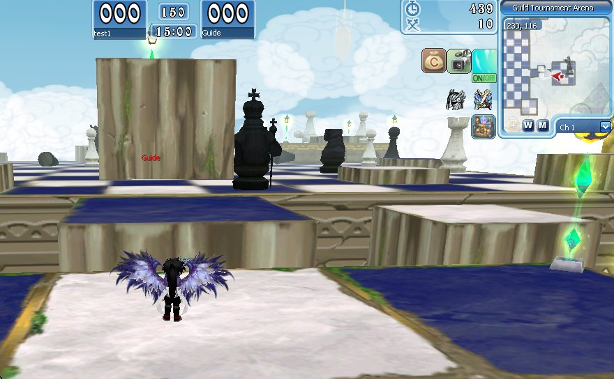
</Frame>

<Frame caption="Info skor guild dan limit waktu pertandingan">
  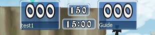
</Frame>

<Frame caption="Skor berjalan dan pesan sistem">
  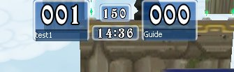
  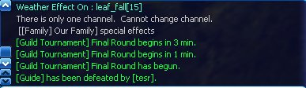
</Frame>

<Note>
  Jika kamu terbunuh player lain, kamu akan respawn secara otomatis dan mendapatkan **barrier selama 10 detik** setelah respawn.
</Note>

<Frame>
  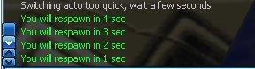
  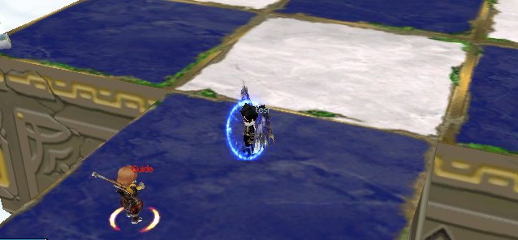
</Frame>

<Frame caption="Field / Arena Guild Tournament">
  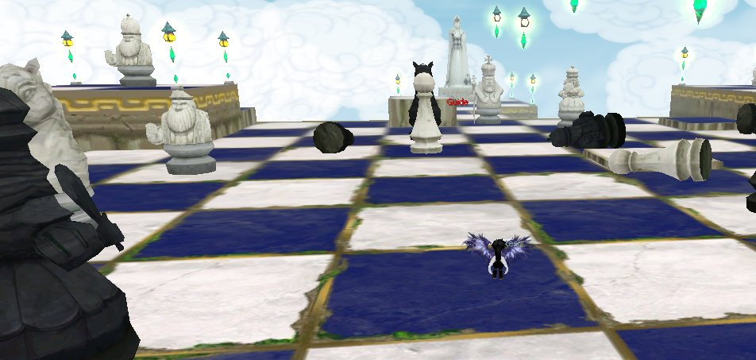
</Frame>

<Frame caption="Hasil pertandingan">
  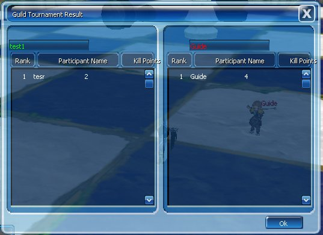
</Frame>
