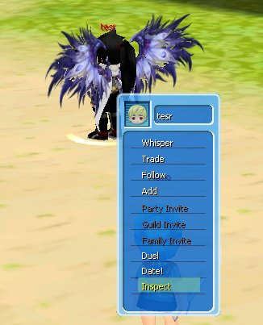
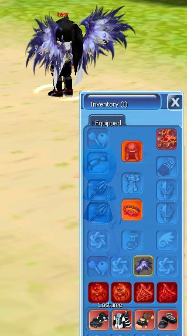

Periksa equipment yang digunakan pemain lain dengan mudah.

<Steps>
  <Step title="Klik kanan karakter pemain">
    Menu interaksi akan muncul.
  </Step>
  <Step title="Pilih Inspect">
    <Frame>
      
    </Frame>
  </Step>
  <Step title="Lihat equipment">
    Equipment yang sedang digunakan pemain tersebut ditampilkan.
    <Frame>
      
    </Frame>
  </Step>
</Steps>
