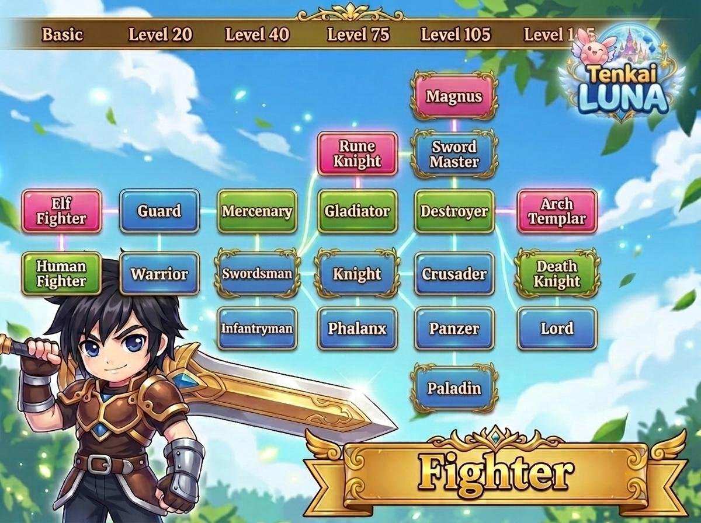
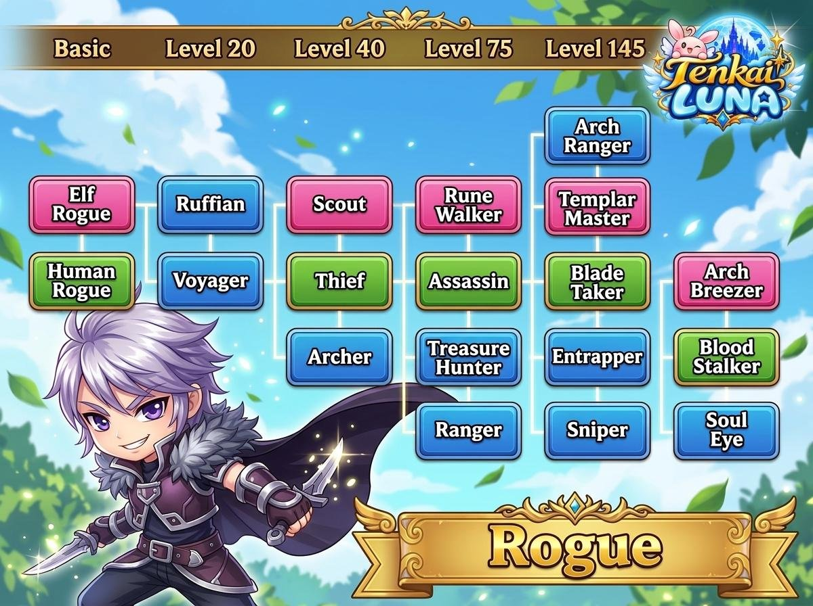

Tentukan jalur petualanganmu melalui fitur Job Tree. Setiap karakter dapat mengembangkan kelasnya secara bertahap sesuai level yang dicapai.

**NPC:** Job Change Manager, Alker Harbor

<Frame>
  
</Frame>

## Level Job Change

| Level | Tahap |
| --- | --- |
| 1 | Base Job — Fighter, Rogue, Mage |
| 20 | Job Change Tahap 1 |
| 75 | Job Change Tahap 2 |
| 105 | Job Change Tahap 3 |

Setiap jalur memiliki perkembangan job hingga Tier 4 dengan pilihan kelas yang berbeda.

<Note>
  Gambar job tree di bawah menampilkan kolom tier pada Level 20, 40, 75, 105, dan 145.
</Note>

## Fighter

<Frame>
  
</Frame>

## Mage

<Frame>
  
</Frame>

## Rogue

<Frame>
  
</Frame>
