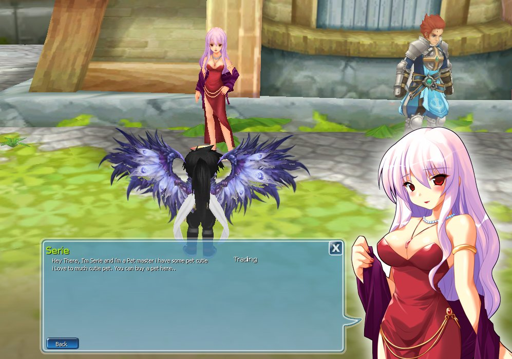
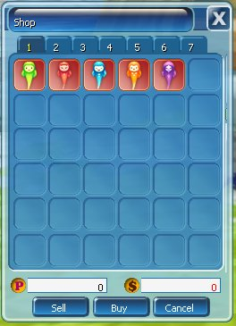
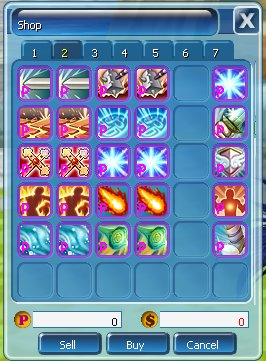

Pet System memungkinkan pemain memiliki hewan peliharaan (Pet) yang menemani dan membantu selama berpetualang di dunia Luna.

## Fungsi Utama

1. **Membantu Pertarungan:** Pet memiliki skill dan status masing-masing. Ada Pet yang dapat menyembuhkan (heal) atau memberikan tambahan status (buff).
2. **Level & Evolusi:** Pet bisa mendapatkan EXP dan naik level. Pet berevolusi pada **level 20, 50, dan 80** menjadi bentuk yang lebih kuat.

## NPC & Toko

<Frame caption="NPC Serie (Pet Master)">
  
</Frame>

<Frame caption="Common Pet">
  
</Frame>

<Frame caption="Common skill pet / Pet skill level 1">
  
</Frame>

<Tip>
  Hasil panen [Gardening](/fitur/gardening) menyediakan item khusus untuk mendapatkan Pet Skill.
</Tip>
