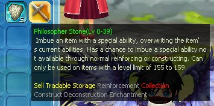
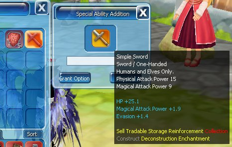

Philosopher System adalah fitur peningkatan yang memungkinkanmu menambahkan opsi status spesial (**Blue Option**) pada senjata maupun equipment yang kamu miliki, tanpa harus mencari senjata atau armor baru yang langka.

## Mekanisme

1. **Penggunaan Philosopher's Stone:** item khusus ini memberikan barisan status tambahan secara acak pada equipment atau senjata. Atribut yang mungkin muncul: STR, INT, DEX, VIT, WIS, HP, MP, Critical Rate, Critical Damage, Speed, hingga Attack Power.
2. **Kesesuaian Level:** Philosopher's Stone terbagi berdasarkan rentang level perlengkapan (misalnya level 0–39, 40–74, hingga 75–99). Batu dan equipment yang digunakan harus memiliki level yang sesuai.
3. **Reroll & Timpa Opsi:** kamu bisa menggunakan Philosopher's Stone berulang kali hingga mendapat kombinasi status terbaik untuk job karaktermu. Setiap kali batu digunakan kembali, opsi tambahan yang lama **digantikan** dengan opsi yang baru.

## Cara Menggunakan

<Steps>
  <Step title="Siapkan batu">
    Pilih Philosopher Stone yang sesuai dengan level equipment-mu.
    <Frame>
      
    </Frame>
    <Frame>
      
    </Frame>
  </Step>
  <Step title="Klik 2x pada Philosopher Stone">
    Klik 2x pada Philosopher Stone yang sesuai level equipment-mu.
    <Frame>
      
    </Frame>
  </Step>
  <Step title="Grant Option">
    Masukkan equipment-mu dan klik **Grant Option** untuk mendapatkan opsi dari Philosopher Stone.
    <Frame>
      
    </Frame>
  </Step>
</Steps>
