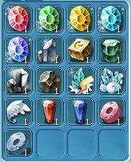
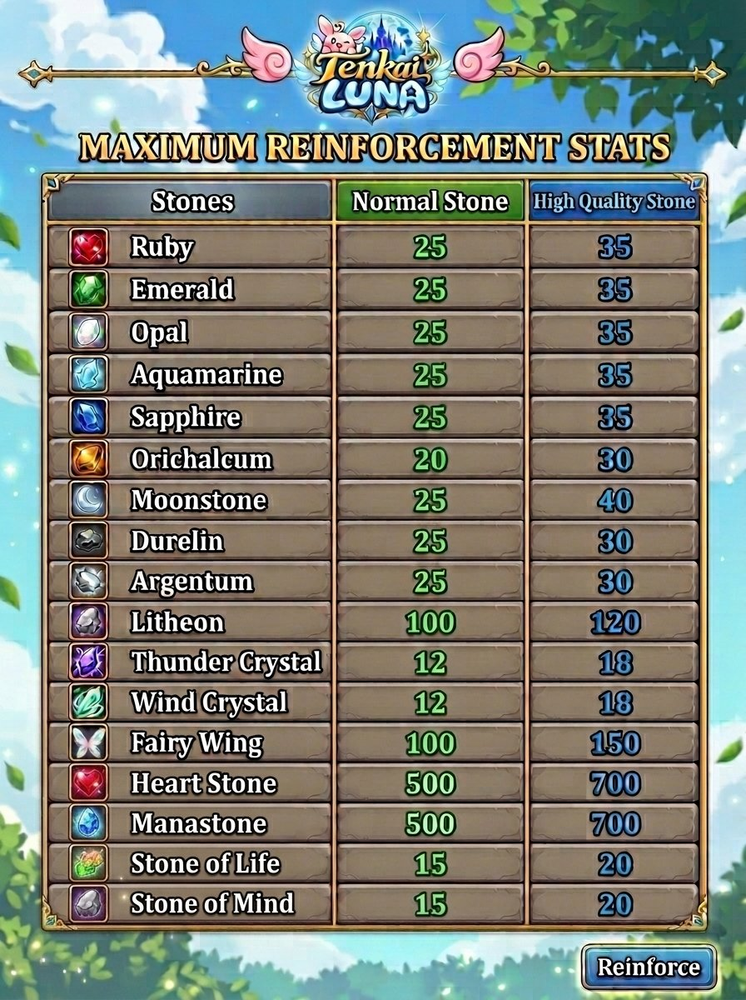

Perkuat equipment untuk meningkatkan kemampuan karakter dalam bertarung. Siapkan material yang sesuai dengan jenis dan kualitas equipment.

**NPC Material:** Tasartia — Materials Merchant, Alker Harbor

## Cara Mengakses

<Steps>
  <Step title="Buka jendela Skill">Tekan **K**.</Step>
  <Step title="Pilih skill Reinforce">Pilih tab **Action**, lalu klik skill **Reinforce**.</Step>
  <Step title="Masukkan equipment">Masukkan equipment yang ingin diperkuat.</Step>
  <Step title="Periksa material">Klik **Compatible Mats** untuk memeriksa material.</Step>
  <Step title="Mulai proses">Siapkan material yang sesuai, lalu klik **Reinforce**.</Step>
</Steps>

## Catatan

- Equipment di bawah Rare menggunakan material sesuai persyaratannya.
- Equipment **Rare ke atas wajib menggunakan High Quality Material**.
- High Quality Material dapat dibuat melalui [Crafting](/fitur/crafting).
- Jangan mencampurkan beberapa jenis Reinforcement Jewel dalam satu proses.
- Peluang kegagalan meningkat jika menggunakan kurang dari 10 Reinforcement Jewels.

<Frame>
  
</Frame>

## Maximum Reinforcement Stats

| Stone | Normal Stone | High Quality Stone |
| --- | --- | --- |
| Ruby | 25 | 35 |
| Emerald | 25 | 35 |
| Opal | 25 | 35 |
| Aquamarine | 25 | 35 |
| Sapphire | 25 | 35 |
| Orichalcum | 20 | 30 |
| Moonstone | 25 | 40 |
| Durelin | 25 | 30 |
| Argentum | 25 | 30 |
| Litheon | 100 | 120 |
| Thunder Crystal | 12 | 18 |
| Wind Crystal | 12 | 18 |
| Fairy Wing | 100 | 150 |
| Heart Stone | 500 | 700 |
| Manastone | 500 | 700 |
| Stone of Life | 15 | 20 |
| Stone of Mind | 15 | 20 |

<Frame caption="Tabel Maximum Reinforcement Stats">
  
</Frame>
