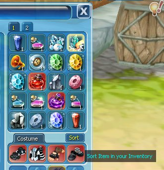
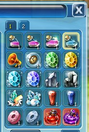

Rapikan isi tas karakter agar item lebih mudah ditemukan dan dikelola.

<Steps>
  <Step title="Buka Inventory">Tekan **I**.</Step>
  <Step title="Cari tombol Sort">Tombol **Sort** ada di bagian kanan bawah.</Step>
  <Step title="Klik Sort">Item tersusun secara otomatis.</Step>
</Steps>

<Frame caption="Sebelum sort">
  
</Frame>

<Frame caption="Sesudah sort">
  
</Frame>
