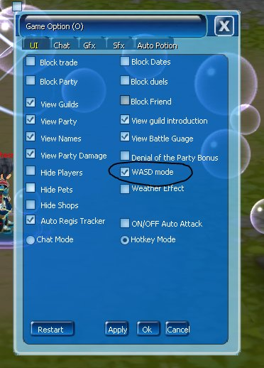

Gunakan tombol **W, A, S, D** untuk menggerakkan karakter.

## Cara Mengaktifkan

<Steps>
  <Step title="Buka Game Option">Tekan **O**.</Step>
  <Step title="Pilih tab UI">Pilih tab **UI**.</Step>
  <Step title="Aktifkan WASD Mode">Centang **WASD Mode**.</Step>
  <Step title="Terapkan">Klik **Apply**.</Step>
</Steps>

<Frame>
  
</Frame>
